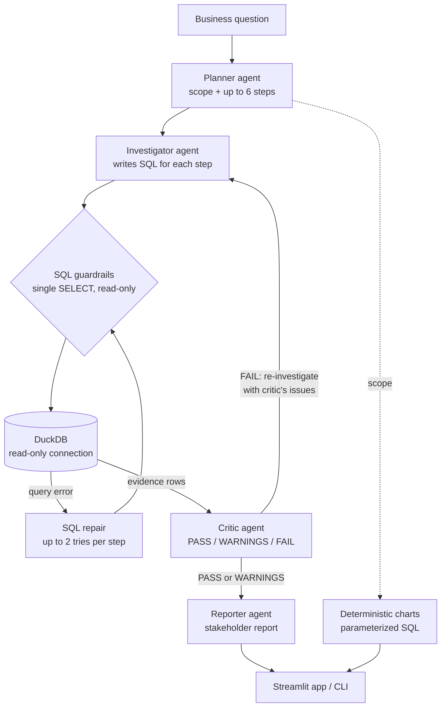
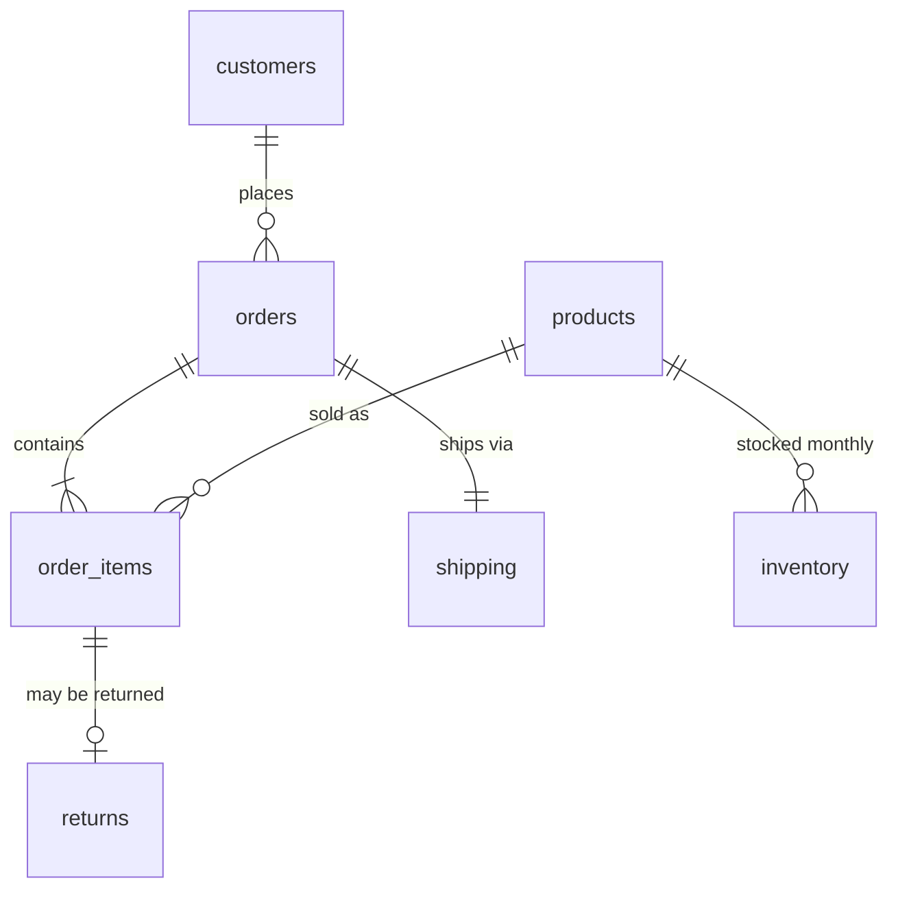

# AnalystOS

**A multi-agent AI analyst that answers "why did this metric change?" over 417,000 order line items, and then checks its own work before it reports.**

Ask a business question in plain English. AnalystOS plans the investigation, writes and runs the SQL, has a separate critic agent review the evidence for analytical mistakes, and writes a stakeholder-ready report. When a query fails it repairs it. When the critic rejects the analysis it investigates again.


---

## Why I built this

Asking an LLM to write SQL is easy. Getting a **correct** business answer is not. The mistakes that matter are quiet ones that still produce a plausible number:

- **Wrong grain.** Late-delivery rate computed over line items instead of orders overweights large orders.
- **Double counting.** Order-level shipping cost summed after joining to line items is inflated by the item count.
- **Adding overlapping breakdowns.** Category, state and channel changes added together count the same transactions three times.
- **Confusing correlation with cause.** "Refunds fell, so refunds drove profit" is a claim the data rarely supports.

AnalystOS is built around preventing those mistakes, not just generating SQL.

---

## Example: a real run

> **Question:** *Why did contribution profit decline in the West from August 2025 to September 2025?*

The planner turned this into six steps: confirm the change, compare operational metrics, break the change down by category and product, by channel and segment, by state, and check that each breakdown independently adds up to the total. An excerpt of the final report:

> **Executive Summary**
> West contribution profit declined by **$31.6K, or 3.3%**, from $956.6K in August to $925.1K in September 2025.
>
> The primary observed financial driver was a **$99.7K decline in gross profit**, associated with lower revenue, orders, units sold and customers. This was partially offset by **$65.8K lower refunds** and **$2.4K lower allocated shipping costs**. The evidence identifies these relationships but does not prove that lower volume or any specific operational factor caused the gross-profit decline.
>
> **Where the Change Was Concentrated**
> Washington (−$28.0K) and Arizona (−$20.0K), partly offset by California (+$11.5K) and Colorado (+$5.0K). By category, Home & Office declined $40.3K while Appliances grew $26.4K. These are areas of concentration, not proof that they caused the regional decline.

**Critic verdict: `PASS_WITH_WARNINGS`.** The critic confirmed that the contribution-profit bridge reconciles to the cent (−$99,741.92 gross profit, +$65,794.45 lower refunds, +$2,391.89 lower shipping = **−$31,555.58**). It flagged that the product list covers only part of the change and that gross profit was not split into price, volume and mix. The report states both limitations instead of hiding them.

The headline number matches ground truth computed directly from the database.

---

## Architecture



### The agents

| Agent | What it does | Key design choice |
|---|---|---|
| **Planner** | Turns the question into an objective, a structured **scope** (metric, region, baseline and comparison periods) and at most 6 analysis steps. | Must end with a reconciliation step, and is told never to add overlapping dimensions together. |
| **Investigator** | Writes one SQL query per step. Python runs it and attaches the real results. | The model never reports numbers itself. Any "evidence" it writes is discarded and replaced with actual query output. |
| **SQL repair** | Gets the failed query and the database error message and returns a fixed query. | Bounded to 2 attempts per step. Every failed query is kept next to its error for auditing. |
| **Critic** | Reviews plan, SQL and evidence against the semantic layer for wrong grain, double counting, non-reconciling breakdowns and unsupported causal claims. | A `FAIL` sends the investigation back once with specific fixes. It reviews existing evidence and never invents new evidence. |
| **Reporter** | Writes the final report: summary, drivers, concentration, offsets, limitations, next step. | Uses only validated findings, and states plainly when the analysis is not reliable. |

---

## Engineering decisions

### 1. A semantic layer as the single source of truth
[`config/semantic_layer.md`](config/semantic_layer.md) defines every metric, table grain and join rule. The critic validates against it directly, and the investigator's prompt encodes the same rules. For example:

- Contribution profit = gross profit − refunds − **allocated** shipping cost.
- Discount rate = `SUM(discount_amount) / SUM(gross_sales)` (sales-weighted), not `AVG(discount_pct)`.
- Return rate is measured per line item; late-delivery rate per order.

Order-level shipping cost is split evenly across each order's line items in the `sales_analysis` view. [`scripts/validate_metrics.py`](scripts/validate_metrics.py) asserts that this reconciles exactly: **$3,066,535 allocated = $3,066,535 shipped.**

### 2. Model-written SQL is treated as untrusted input
"Only write read-only SQL" in a prompt is a request, not a control. Enforcement happens in code ([`src/database.py`](src/database.py)):

| Guardrail | How |
|---|---|
| Database cannot be modified | Every connection opens with `read_only=True` |
| No file reads, writes or `ATTACH` | `enable_external_access=False` |
| Only queries | DuckDB's own parser must see exactly one statement, of type `SELECT` |
| Bounded results | Row cap (200 for evidence), with a `truncated` flag the critic is told about |
| Bounded runtime | Queries are interrupted after 30 seconds |
| No SQL injection in tools | All predefined tools use parameterized queries |

[`scripts/test_sql_guard.py`](scripts/test_sql_guard.py) checks each of these, including `DROP`, `COPY … TO`, `ATTACH`, `SET`, statement stacking, `read_csv` on local files, an injection string, and a runaway cross join.

### 3. Structured outputs and live schema
- The planner, investigator, critic and repair agents use **strict JSON-schema outputs**, so a reply can't drift out of format.
- The investigator gets the **live database schema** at runtime. This fixed the one failing evaluation question: without it, the model guessed a table name (`order_shipping`) that doesn't exist and the delivery analysis failed even after repair.

### 4. Charts never depend on the LLM
The KPI cards, profit bridge and category chart in the UI are computed with **parameterized SQL from the planner's scope**, not parsed out of model-generated results. The numbers on screen are exact even when the narrative isn't perfect.

---

## Evaluation

Prompt changes in LLM systems are hard to judge by eye, so the project has a known-answer evaluation ([`scripts/eval_pipeline.py`](scripts/eval_pipeline.py)). Ground truth is **computed from the database at run time**, so it can't go stale. Each question is scored on:

- Did the planner extract the right region and periods?
- Does the correct answer appear in the SQL evidence?
- Does it appear in the final report?
- Did the critic avoid a `FAIL`, and did every SQL step succeed?

**Latest run:**

| Question | Ground truth | Scope | Evidence | Report | Critic | Result |
|---|---|---|---|---|---|---|
| West contribution profit, Aug → Sep 2025 | −$31,555.58 | ✅ | ✅ | ✅ | PASS_WITH_WARNINGS | **PASS** |
| South revenue, Q1 → Q2 2025 | +$359,186.46 | ✅ | ✅ | ✅ | PASS_WITH_WARNINGS | **PASS** |
| All-region gross profit, 2024 → 2025 | +$97,831.68 | ✅ | ✅ | ✅ | PASS_WITH_WARNINGS | **PASS** |

Across the three questions, 3 SQL errors were fixed automatically by the repair agent and no steps failed. In an earlier run, the critic rejected a broken reconciliation query and the second investigation fixed it, which is the self-correction loop working as intended.

---

## The dataset

A synthetic but realistic retail business, generated reproducibly (fixed seed) by [`scripts/generate_data.py`](scripts/generate_data.py):

| | |
|---|---|
| Time span | January 2024 – December 2025 |
| Customers | 30,000 across 4 regions, 16 states, 3 segments |
| Products | 2,000 across 4 categories and 15 subcategories |
| Orders | 250,000 |
| Order line items | 417,344 |
| Returns | 33,623 |
| Also included | Shipping, monthly inventory, marketing spend, regional targets |



Two analytical views sit on top: `sales_analysis` (one row per line item with profit, refunds and allocated shipping) and `monthly_performance` (month × region rollup).

---

## Getting started

**Requirements:** Python 3.14 (the version used in development) and an OpenAI API key.

```bash
git clone https://github.com/kedarmhetre04/analyst-os.git
cd analyst-os

python -m venv venv
source venv/bin/activate
pip install -r requirements.txt

echo "OPENAI_API_KEY=your-key-here" > .env
```

The generated data and the DuckDB database are included. To rebuild them from scratch:

```bash
python scripts/generate_data.py   # writes data/*.csv
python -m src.database            # loads CSVs and creates the views
```

**Run it** (all commands from the repository root):

```bash
streamlit run app.py               # web app: KPIs, charts, report, critic verdict, full audit trail
python -m scripts.run_analystos    # same multi-agent pipeline in the terminal
python -m scripts.chat             # single tool-calling agent for quick questions
```

**Test it:**

```bash
python -m scripts.test_sql_guard   # guardrail tests, no API calls
python -m scripts.validate_metrics # shipping allocation reconciles exactly
python -m scripts.eval_pipeline    # end-to-end evaluation (makes real LLM calls)
```

The model is set in [`src/llm.py`](src/llm.py), and separately in [`src/agent.py`](src/agent.py) for the chat agent.

---

## Project structure

```
analyst-os/
├── app.py                    # Streamlit front end
├── config/
│   └── semantic_layer.md     # metric definitions, grains, join rules
├── src/
│   ├── pipeline.py           # orchestration and critic-driven retry loop
│   ├── planner.py            # planner agent (structured scope + steps)
│   ├── investigator.py       # SQL generation, execution, repair
│   ├── critic.py             # validation agent
│   ├── reporter.py           # stakeholder report agent
│   ├── llm.py                # shared client, structured outputs, retries
│   ├── database.py           # DuckDB loading, views, SQL guardrails
│   ├── visualizations.py     # deterministic chart queries from scope
│   ├── tools.py              # predefined analytics tools
│   ├── investigation.py      # parameterized drill-down tools
│   └── agent.py              # single tool-calling chat agent
├── scripts/
│   ├── generate_data.py      # synthetic dataset generator
│   ├── eval_pipeline.py      # known-answer end-to-end evaluation
│   ├── test_sql_guard.py     # guardrail tests
│   ├── validate_metrics.py   # metric reconciliation check
│   └── run_analystos.py, chat.py, test_*.py
└── data/                     # generated CSVs
```

---

## How it evolved

The project was built in stages, each fixing a weakness found in the previous one:

| Date | Milestone |
|---|---|
| Sep 16, 2026 | Project setup and synthetic data generator |
| Sep 18 | First tool-calling agent connected to the OpenAI API |
| Sep 20 | Reworked sales metrics; shipping cost allocated per line item so totals reconcile |
| Sep 25 | Semantic layer: one shared definition for every metric and grain |
| Sep 27 | Autonomous root-cause investigation workflow |
| Sep 28 | Split into planner and investigator agents |
| Sep 30 | Critic agent with stricter validation and reconciliation checks |
| Oct 1 | Complete end-to-end pipeline: plan → investigate → critique → report |
| Oct 3 | Streamlit front end |
| Oct 13 | SQL guardrails, self-repairing SQL, critic-driven re-investigation, structured outputs, evaluation harness |

---

## Limitations and roadmap

Being clear about what doesn't work yet is part of building analytics people can trust.

- **Small evaluation set.** Three questions, each run once. LLM output varies between runs; the next step is 20+ questions, including ones without a period comparison, run several times each.
- **One rollup view still breaks the rules.** `monthly_performance` computes late delivery per line item and uses an average discount percentage. Fixing it requires a database rebuild.
- **Descriptive, not causal.** The system explains where a change happened and what it coincided with. It deliberately doesn't claim causes; a gross-profit decomposition into price, volume and mix is the next analytical capability.
- **Unused data.** Marketing spend, targets and inventory are loaded but not yet used by any agent.
- **Synthetic data.** Realistic in structure and scale, but generated, not real.

---

## Author

**Kedar Sunil Mhetre** · [GitHub @kedarmhetre04](https://github.com/kedarmhetre04)
